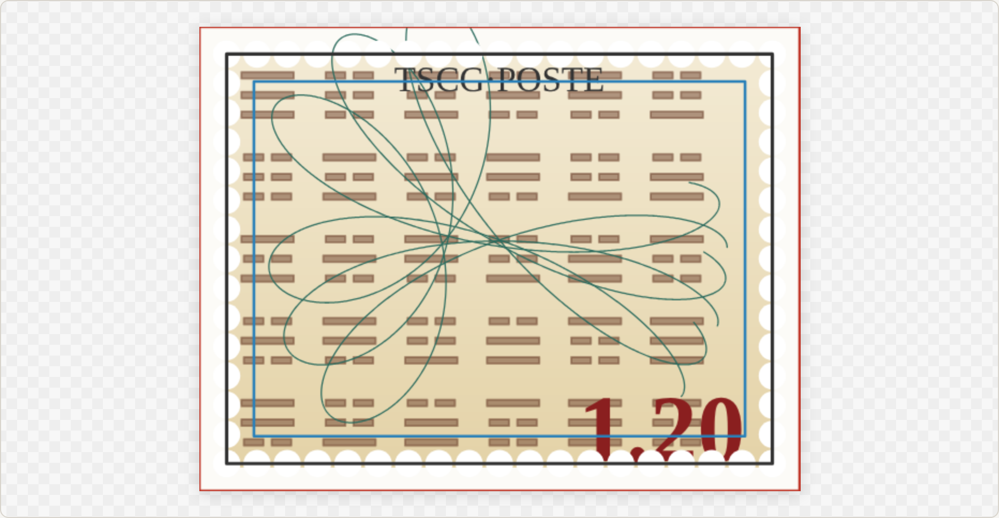

# Layout Designer

An **ElectronJS** tool for composing **fixed-format print artifacts** — postcards,
stamps, fantasy/"Monopoly" banknotes, ID-1 (credit-card format) cards, ATC/ARC,
playing and tarot cards.

> Status: **first prototype** — a runnable vertical slice of the v0.4 architecture
> (`docs/LayoutDesigner_ARCHITECTURE.md`). See `README_PROTOTYPE.md` for the file map and
> what is built vs deferred.



## Design in one breath

- **Domain-free core + plugins.** The core knows documents, layers, regions, commands
  and a rendering façade — nothing about stamps. Every print-domain notion (formats,
  fill, pattern, guilloche, text, perforation…) is a **plugin**.
- **One drawing surface: the `gfx` façade.** No layer or primitive touches a raw canvas.
  Everything draws **in millimetres**, in one frame, with normalized anchors. P5's
  anchor quirks are absorbed in one place; `CanvasTarget` today, `SvgTarget` (export)
  next, same contract.
- **Three file formats (live/frozen axis):** `.lydoc` (document), `.lygrid` (pattern
  grid-DSL), `.lypart` (frozen SVG component).
- **Every mutation is an undoable Command.**

## Run

```bash
# Electron (target)
npm install
npm start

# Browser (fast preview, needs a static server — ES modules don't load from file://)
npx serve .      # then open http://localhost:3000/demo.html
```

## Repository layout

```
src/core/            model, undo, commands, session, registry, i18n
src/core/render/     gfx façade (facade.js) + compositor
src/core/geometry/   grid layout, guilloche math
builtin-plugins/     formats-print, layer-{fill,pattern,guilloche,text,perforation}
src/renderer/app.js  app wiring + DOM UI      · demo.html  browser host
main.js / preload.cjs  Electron shell
assets/              iching.lygrid.js (mini-language reference sample)
docs/                architecture spec + reboot-kit (Claude lazy-loading corpus)
cli_tools/           ld_generate_filetree.py
```

## Working with Claude on this repo

`docs/reboot-kit/` holds a **lazy-loading corpus** so a Claude project can work on this
repo without loading the whole thing each conversation: a router
(`LD_ReferenceCorpus.md`), invariants (`LD_ReferenceCorpus_Bootstrap.md`), a generated
path map (`LD_FileTree.md`), and a session loader (`LD_SmartPrompt.md`). Set-up is in the
Bootstrap file, §A. Regenerate the file tree after structural changes:
`python cli_tools/ld_generate_filetree.py` (from the repo root).

## License

BSD 3-Clause (see `LICENSE`). Author: Echopraxium (Michel), with Claude AI.
